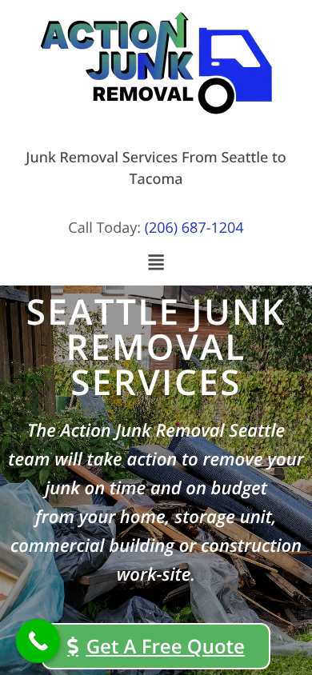
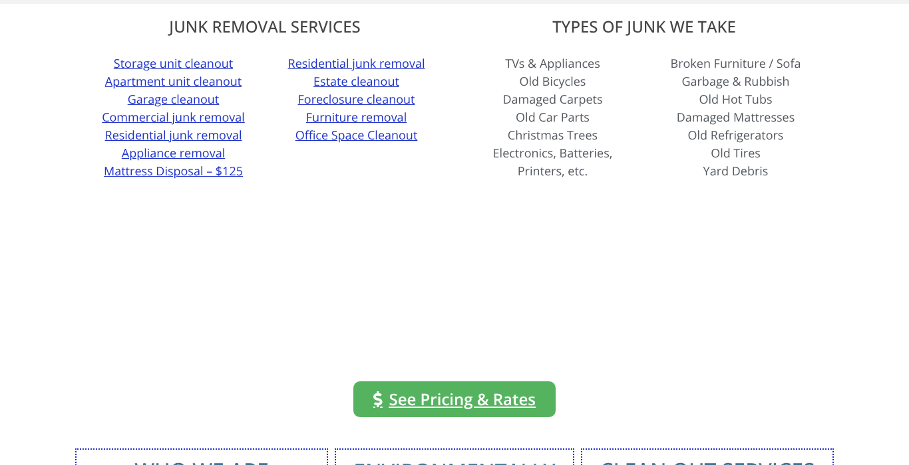
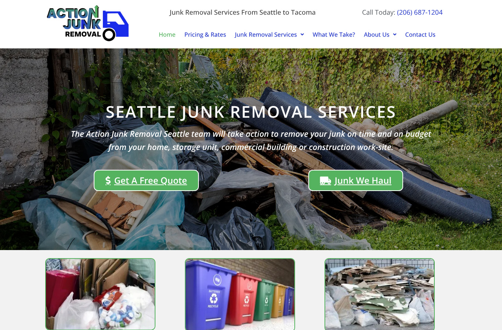

# Website Audit: Action Junk Removal Seattle

**Website:** actionjunkremovalseattle.com
**Prepared for:** Paul Cornell
**Date:** October 27, 2026

## Summary

Your site has a better base than most junk removal sites in the Seattle area. You have a page for every service and for 14 cities, a clear price table, and a phone number you can tap on every page. Google has a lot to work with.

The problem is what happens after someone lands. A person with a garage full of junk wants three things fast: what will it cost, can you come soon, and can I trust you. Right now the homepage answers none of these clearly. That is where calls are being lost.

Below are the 10 things we found, ordered by how much money we think each one is costing you.

| # | Issue | Impact | Effort to fix |
|---|---|---|---|
| 1 | No quote form on the homepage, and the form elsewhere has 10 fields | High | Low |
| 2 | "We reply within 12 hours, Mon to Fri" contradicts "same day, 7 days a week" | High | Low |
| 3 | Your prices are hidden on a separate page | High | Low |
| 4 | No reviews visible anywhere | High | Low |
| 5 | Mobile first screen is mostly logo | High | Medium |
| 6 | Four different addresses across your site and listings | Medium | Low |
| 7 | Another "Action Junk" company competes for your name | Medium | Medium |
| 8 | Large empty gap in the middle of the homepage | Medium | Low |
| 9 | Hero photo shows junk, not the result or your team | Medium | Low |
| 10 | Typos and generic copy | Low | Low |

## The 10 findings

### 1. No quote form on the homepage, and the real form has 10 fields

**What we found:** The homepage has a "Get A Free Quote" button, but it sends people to another page. The form there asks for 10 things: full name, email, phone, street, apartment, city, state, ZIP, junk type, and one more field.

**Why it costs you:** Every extra click and every extra field loses people. Junk removal is an impulse decision. Someone finally decides to clear the garage, and if it takes more than a minute, they call the next company on Google instead.

**Fix:** Put a short form right on the homepage, at the top. Ask for 4 things only: name, phone, ZIP code, and "What are we hauling?" Add an option to upload or text a photo of the junk. Photos let you quote without a site visit, and people love not having to describe it.

### 2. Your reply promise works against you

**What we found:** The form says *"one of our Junk Specialists will usually reply to any request inside of 12 hours Monday to Friday."* The same site says you haul 7 days a week, 8am to 7pm, with same-day service.

**Why it costs you:** Someone filling in your form on a Saturday morning reads that they might hear back on Monday. Most people request quotes from 2 or 3 companies at once. The first one to reply usually gets the job.

**Fix:** Change it to something like "We reply within 1 hour, 7 days a week, 8am to 7pm." Then make it true with an automatic text reply that goes out the second a form comes in.

### 3. Your prices are hidden

**What we found:** Your pricing page is one of the best things on the site. It has a clear table from $145 minimum to $625 for a full truck. But the homepage only says pricing is "based on size and weight." The only price on the homepage is mattress disposal for $125.

**Why it costs you:** "How much?" is the first question every customer has. Many competitors hide their prices. Showing yours is a reason to choose you, but only if people see it.

**Fix:** Put a simple visual on the homepage: a truck graphic with 1/4, 1/2, 3/4, and full load, and the price under each. Add "Most garage cleanouts are a 1/2 load" so people can picture where they land.

### 4. No reviews visible

**What we found:** The homepage has a Google Reviews logo that links to your map listing. It shows no star rating, no review count, and no customer quotes. There are no reviews on any page we checked.

**Why it costs you:** You are asking a stranger to send a crew onto their property. Reviews are the fastest way to earn that trust. A badge with no number makes people wonder why the number is not there.

**Fix:** Show your Google star rating and review count near the top of the homepage. Add 3 to 5 real reviews with the customer's first name and neighborhood, for example "Sarah, West Seattle." Then add a short text you send after every job asking for a review, to keep new ones coming.

### 5. On mobile, the first screen is mostly logo

{ width=40% }

**What we found:** On a phone, the logo, a tagline, and a small phone number take up the top half of the screen. The headline and the quote button get pushed down. The green floating call button also sits on top of the "Get A Free Quote" button.

**Why it costs you:** Most junk removal searches happen on a phone. The first screen decides if they stay or go back to Google.

**Fix:** Make the header slim, with the logo small on the left and a tap-to-call button on the right. Add a bar fixed to the bottom of the screen with two buttons, "Call" and "Text a photo." Move the floating button so it does not cover anything.

### 6. Four different addresses

**What we found:** Your business shows up with four different addresses:

- Homepage footer: 3504 SW Webster St #112, Seattle
- Contact page "Corporate Office": 4727 Beacon Ave S #7, Seattle
- Contact page "Tacoma Office": 4302 Center St #Z105, Tacoma
- Washington state business record: 5214 25th Ave S, Seattle

The map on the contact page also searches for "Beacon Ave", not the footer address.

**Why it costs you:** Google ranks local businesses on the map partly by how consistent their name, address, and phone number are across the web. Mixed addresses make Google less sure about you, which can push you down in the map results.

**Fix:** Pick the one address your Google Business Profile uses. Use it in the footer, on the contact page, in the map, and in the hidden business info Google reads. If the Tacoma office is real, give it its own Google profile and its own page.

### 7. Another "Action Junk" company competes for your name

**What we found:** "Action Junk Hauling" (actionjunkhauling.com and actionjunkremoval.com, phone 206-800-7198) also targets Seattle and Tacoma. Some online directories mix the two companies up and show your details next to theirs.

**Why it costs you:** Someone who heard about you from a friend and searches "Action Junk Removal" may call them instead.

**Fix:** Claim and correct your listings on the main directories so they show your number. Use your full name, "Action Junk Removal Seattle", the same way everywhere. Consider a short line on your site such as "Owner-operated by Paul Cornell" so people know they found the right company. *If either of those sites is also yours, let us know and we will adjust this point.*

### 8. Large empty gap in the middle of the homepage

{ width=90% }

**What we found:** Under the services and junk lists there is a block of empty white space with only a "See Pricing & Rates" button in it. It looks like something failed to load.

**Why it costs you:** Blank space like this makes a site look broken or unfinished. People quietly lose trust and leave.

**Fix:** Remove the gap, or better, put the price table from point 3 there.

### 9. The hero photo shows junk, not the result

{ width=90% }

**What we found:** The main photo is a pile of debris and garbage bags. The other photos are stock images of bins and garbage. There is no photo of you, your crew, or your truck anywhere on the homepage.

**Why it costs you:** Customers already know what their junk looks like. What they want to see is the empty garage, and the people who will show up. Your site says you are local, owner-operated, and minority-owned. Those are real strengths, but nobody can see them.

**Fix:** Use a real photo of you and your truck in the top section. Add a before and after strip from 3 real jobs: a full garage, then the same garage empty.

### 10. Typos and generic copy

**What we found:**

- "Action Junk Removal of Seattle and **Tacoam**"
- "Our drivers **comes** out to your location"
- "We arrive at **you given** place and time"
- The main headline mentions only Seattle, while Tacoma is half your service area.
- A long paragraph about "trust, respect, and integrity" that could be on any company's website.

**Why it costs you:** Small typos make a business look careless, and a careless junk hauler is exactly what people are afraid of hiring. The generic paragraph takes space that could go to reviews or prices.

**Fix:** Correct the typos. Change the headline to "Junk Removal from Seattle to Tacoma, Same Day, 7 Days a Week." Replace the values paragraph with three short, specific promises, for example "We text you when we are 30 minutes out," "Price confirmed before we load anything," "We sweep up when we are done."

## What is already working

- A separate page for each service and each city. This is a strong base for Google.
- A clear, honest price table.
- Tap-to-call phone number on every page.
- Hidden business details for Google are already in place.
- Open 7 days a week, 8am to 7pm. This is a selling point. Make it louder.

## Quick wins for the next 7 days

These need no redesign and could start bringing in calls this week:

1. Change the "12 hours, Monday to Friday" reply line (finding 2).
2. Fix the three typos (finding 10).
3. Make the footer, contact page, and map use the same address (finding 6).
4. Put the price table on the homepage in place of the empty gap (findings 3 and 8).
5. Add your Google rating and 3 real reviews near the top (finding 4).

## A note on how we checked

We tested the homepage on desktop and on an iPhone-sized screen, and looked at the pricing, contact, and service pages. We also checked public business listings. The desktop homepage loaded in about 4 seconds and downloaded about 2.3 MB in our test. That is acceptable, but compressing the top photo would make it faster on phones. We did not have access to your Google Business Profile or call data. With those, we could tell you how many calls each of these fixes is likely worth.
